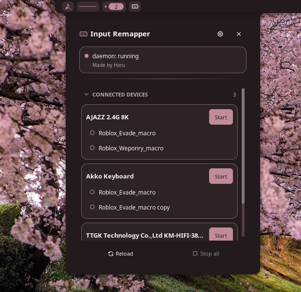
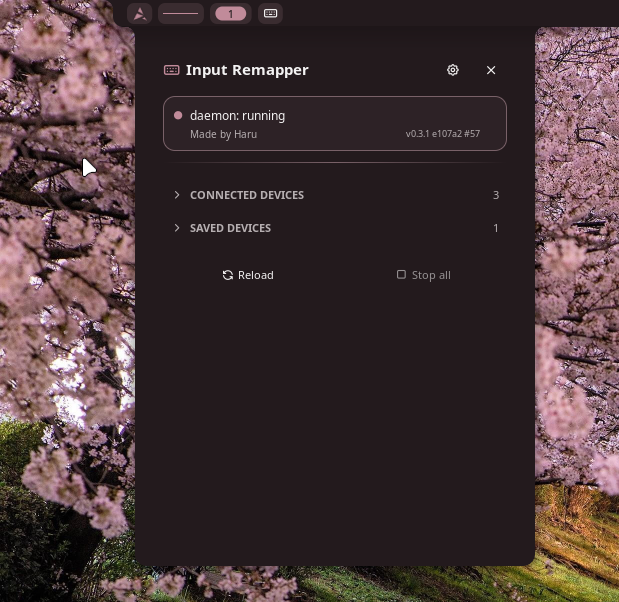

# Input Remapper for Noctalia v5

A plugin that lets you switch [input-remapper](https://github.com/sezanzeb/input-remapper)
presets directly from the bar. No password prompts, no window juggling, one
right-click to stop everything.

Target: Noctalia v5.0.0+ (`plugin_api = 18`) / input-remapper 2.x

This is my very first project, so please go easy on me!

## Warning!!!
This plugin is made for runit and didn't tested on other init system (e.g. openrc, systemd)

## Example



## Installation is two steps

**Install the runit service first.** Skipping this means you'll still get a
password prompt every time, even with the plugin installed.

### 1. Keep the daemon resident as root (Artix / runit)

The password prompt exists because `input-remapper-service` isn't resident -
the GUI re-launches it as root via `pkexec` every single time. Running it as
a runit system service from boot removes that path entirely.

```sh
# Confirm the binary's location first (on Arch/Artix, /usr/sbin is a symlink to /usr/bin)
command -v input-remapper-service

sudo mkdir -p /etc/runit/sv/input-remapper/log
sudo cp runit/input-remapper/run     /etc/runit/sv/input-remapper/run
sudo cp runit/input-remapper/log/run /etc/runit/sv/input-remapper/log/run
sudo chmod +x /etc/runit/sv/input-remapper/run /etc/runit/sv/input-remapper/log/run
sudo mkdir -p /var/log/input-remapper

# enable
sudo ln -s /etc/runit/sv/input-remapper /run/runit/service/

# verify
sudo sv status input-remapper
input-remapper-control --command hello     # -> Daemon answered with "hello"
```

`run` waits on `sv check dbus` before exec'ing. input-remapper publishes
`inputremapper.Control` on the system bus, so starting before dbus is up
would fail.

If something's off, check `sudo tail -f /var/log/input-remapper/current`.

> **About the GUI**: recording a *new* mapping still needs root, because
> `input-remapper-reader-service` requests it separately. You'll still see a
> prompt there. Applying or stopping presets - what this plugin does - never
> triggers one.

### 2. Drop in the plugin

```sh
mkdir -p ~/.local/share/noctalia/plugins
rm -rf ~/.local/share/noctalia/plugins/input-remapper
cp -r input-remapper ~/.local/share/noctalia/plugins/
```

The `rm -rf` first matters: if a same-named directory already exists,
`cp -r` nests the copy inside it instead of overwriting.

Enable **Input Remapper** under Noctalia's Settings → Plugins, then add the
`haru/input-remapper:indicator` widget to your bar wherever you like.

`.luau` files hot-reload automatically, but `plugin.toml` only takes effect on
the next config reload. **Fully restart Noctalia whenever you swap in a new
version** - a hot reload alone can leave the script and the manifest on
different generations at the same time.

---

## Usage

| Action | Effect |
|---|---|
| Left-click the widget | Toggle the panel |
| Right-click the widget | Stop everything that runs (input-remapper injections and keyboard & mouse mode) |
| Middle-click the widget | Widget settings (standard Noctalia behavior) |
| Click a preset row | Start it. Click the running row again to stop it |
| Stop on a running device card | Stop whatever runs on that device |
| Make single-pad copy | Shown under a gamepad running a preset that cannot be hidden from games, see [Hiding the original controller](#hiding-the-original-controller) |
| Games see it as: Controller / Keyboard & Mouse | Gamepads only. How the controller's presets are run, see [Keyboard & Mouse mode](#keyboard--mouse-mode) |
| Tune | Open the plugin settings (keyboard & mouse tuning lives there) |
| Reload (header) | Rescan presets and re-check the daemon |
| Stop all (footer) | Stop everything that runs |

A running card shows `Running · <preset>` under its name, and the running row
is marked `ACTIVE`.

Bar widget:

| Looks like | Means |
|---|---|
| Keyboard glyph, muted | Nothing is running |
| Keyboard glyph + preset name | One preset runs |
| Keyboard glyph + number | Several presets run |
| Mouse glyph + preset name | A controller runs a preset as keyboard & mouse |
| Crossed-out keyboard in the error color | The input-remapper daemon is not reachable |

Also reachable over IPC:

```sh
noctalia msg panel-toggle haru/input-remapper:panel
noctalia msg plugin haru/input-remapper:service all reload
noctalia msg plugin haru/input-remapper:service all stop-all
```

---

## Keyboard & Mouse mode

Every gamepad card has a **Games see it as** switch:

- **Controller** - input-remapper runs the preset as usual.
- **Keyboard & Mouse** - the bundled `ds4kbm` runs the *same* preset instead,
  and games never see a gamepad. The real controller (plus its touchpad and
  motion-sensor nodes) is grabbed exclusively, and only a virtual keyboard and
  a virtual absolute pointer are exposed.

This is meant for games that switch their controls or UI based on the *last
input device*. A DS4 stick drifts a few units around center all the time, so
such a game keeps flipping between gamepad and mouse mode and the UI flickers.
In keyboard & mouse mode the game only ever sees keyboard and mouse input.

The choice is remembered per device. Switching while a preset runs moves that
preset over to the other mode.

| Controller | Output in keyboard & mouse mode |
|---|---|
| Left stick X | Cursor X, absolute. Snaps back to the screen center when released, smoothed against stick jitter |
| R2 / L2 | Left / right mouse button. By default the button is pulsed with a duty cycle that follows the trigger depth, so a half-pulled trigger acts like a half-pressed pedal |
| Everything else | Whatever the preset maps it to |

Events are only emitted when the output actually changes, and the stick has a
deadzone, so an idle controller produces no input at all.

### Which mappings work

ds4kbm reads the preset JSON itself (it does not use input-remapper's code),
and supports what a keyboard & mouse can express:

| Mapping | Supported |
|---|---|
| Button → key (`KEY_V`) | Yes |
| Button → mouse button (`BTN_LEFT`, `BTN_RIGHT`, `BTN_MIDDLE`, `BTN_SIDE`, `BTN_EXTRA`) | Yes. May share a button with R2 / L2; it stays pressed while either holds it |
| Button → `hold_keys(KEY_LEFTSHIFT, KEY_E)` | Yes. Pressed in order, released in reverse |
| D-pad / axis past a threshold → key | Yes |
| Anything with gamepad output | No - showing a gamepad is what this mode avoids |
| Left stick X, R2, L2 as inputs | No - used for the cursor and clicks |
| Other macros, combinations, analog axis mappings | No |

Unsupported mappings are skipped: the panel shows `N mappings skipped` under
the preset, and ds4kbm logs each one to `$XDG_RUNTIME_DIR/ds4kbm.log`. A
preset with no usable mapping at all is greyed out in keyboard & mouse mode.

Mappings are set up in the input-remapper GUI as usual. To adapt a preset for
this mode without changing the original, copy it in the GUI and edit the copy
(for example map R1 to `BTN_RIGHT` with the `mouse` target as a second brake).

### Requirements

- `python` 3 and [`python-evdev`](https://python-evdev.readthedocs.io/)
  (Arch/Artix: `sudo pacman -S python-evdev`)
- `util-linux` (`flock`, `setsid`)
- Read access to `/dev/input/event*` and write access to `/dev/uinput` as
  your normal user. The usual way is membership in the `input` group:

  ```sh
  sudo usermod -aG input "$USER"   # then log out and back in
  ls -l /dev/input/event* /dev/uinput   # both must be accessible to you
  ```

  If `/dev/uinput` is `root:root 600` on your system, add a udev rule:

  ```sh
  echo 'KERNEL=="uinput", GROUP="input", MODE="0660", OPTIONS+="static_node=uinput"' \
    | sudo tee /etc/udev/rules.d/99-uinput.rules
  sudo udevadm control --reload && sudo udevadm trigger
  ```

No root is needed at runtime and no service has to be installed. The screen
size does not need to be configured: the pointer is absolute, so the
compositor maps it to the output (on a multi-monitor layout it spans the whole
layout).

### Tuning

Cursor and trigger behavior are plugin settings (the **Tune** button opens
them, see [Settings](#settings)). Changing one restarts a running ds4kbm with
the new values.

### Without the panel

```sh
ds4kbm/ds4kbm-ctl start "$HOME/.config/input-remapper-2/presets/Wireless Controller/My preset.json"
ds4kbm/ds4kbm-ctl stop
ds4kbm/ds4kbm-ctl status          # "on" + preset path, or "off" (exit code 0 / 1)
ds4kbm/ds4kbm-ctl analyze DIR     # usable / skipped mapping counts per preset, as JSON
ds4kbm/ds4kbm.py --help           # tuning options accepted after the preset in "start"
```

`start` releases the device from input-remapper first and replaces a running
instance, so it also switches presets. Concurrent calls are serialized with
`flock`, and `ds4kbm.py` itself holds an exclusive lock on its pidfile while
it runs, so a second instance refuses to start no matter how it was launched.
`ds4kbm-ctl` uses that lock as the source of truth, so it also finds and stops
an instance started by hand. `stop` waits until the process is gone and the
grab is released, then empties the pidfile.

If ds4kbm loses the controller (Bluetooth drop), it keeps running and grabs
it again when it reconnects.

---

## Hiding the original controller

input-remapper grabs the real controller, but a grab only silences it - the
device node stays, and games using SDL still list it, usually as the *first*
controller. A game that only reads the first controller (Roblox character
movement in Sober, for example) then reads a controller that never moves,
while the preset's output arrives on input-remapper's virtual gamepad listed
after it.

So while a gamepad runs a preset in Controller mode, the plugin hides the
original from games: its device node becomes readable by root only, and the
handles games already hold on it are revoked. Games drop the controller
right away, even while running, and are left with input-remapper's gamepad
as the first one. input-remapper runs as root and keeps reading. When the
preset stops (or Stop all, the widget's right click, the daemon going away,
the setting turned off), the controller is made visible again and games
pick it up without a restart.

The card says `Original controller hidden from games` while this is in
effect. Turn it off with the `hide_original` setting.

### Only single-pad presets can be hidden

input-remapper passes every event no mapping takes to a *forwarded copy* of
the controller, which has the same name and also counts as a controller. A
preset that maps only some buttons (say, one that just swaps Cross and
Circle) therefore splits the controller across two virtual pads: the mapped
buttons on input-remapper's gamepad, the sticks and everything else on the
forwarded copy. Hiding the copy would lose the sticks, and not hiding it
leaves the game with two controllers, so such a preset is left alone.

A *single-pad* preset maps every button and axis of the controller, so the
forwarded copy never says anything and is hidden together with the original.
When a gamepad runs a preset that is not single-pad, the card says how many
buttons and axes it leaves out and offers **Make single-pad copy**: it writes
`<preset> Single Pad.json` next to it, with the same mappings plus a 1:1
mapping to input-remapper's gamepad for every button and axis that was left
out (axes without an extra deadzone; games have their own). The original
preset is not changed. Start the copy instead of the original.

The controller has to be connected for this: which buttons and axes it has is
read from the kernel. Combinations do not count as covering their buttons.

### Installing the helper

Changing a device node's permissions and revoking other programs' handles
needs root, so it is done by a small root-owned helper, `noctalia-padhide`,
that the plugin runs with `sudo -n` (it never prompts). It only touches
`/dev/input/event*` character devices the kernel lists as a joystick with
exactly the given name, refuses input-remapper's own virtual gamepad, and
only revokes handles of non-root processes.

Install it where you cannot change it, then allow exactly that one command
without a password:

```sh
# from the plugin directory
sudo install -o root -g root -m 0755 padhide/noctalia-padhide /usr/local/bin/noctalia-padhide

# /etc/sudoers must read files from /etc/sudoers.d (prints "@includedir /etc/sudoers.d")
sudo grep -n includedir /etc/sudoers

# opens an editor; add the line below (with your user name), save and quit
sudo visudo -f /etc/sudoers.d/noctalia-padhide
# "visudo: no editor found" means vi is not installed; name another editor:
sudo env EDITOR=nano visudo -f /etc/sudoers.d/noctalia-padhide
```

```
youruser ALL=(root) NOPASSWD: /usr/local/bin/noctalia-padhide
```

`visudo` checks the syntax before saving, so a typo cannot lock you out of
`sudo`. Check that it works without a password (this only restores the
default permissions, so it is safe to run any time):

```sh
sudo -k
sudo -n /usr/local/bin/noctalia-padhide show 'Wireless Controller'   # your controller's name
```

Without the helper everything else keeps working; a single-pad preset just
runs without hiding, and the card says `Couldn't hide the original
controller`. After installing the helper, change any plugin setting (or
restart Noctalia) to make the plugin try again.

The installed copy does not update with the plugin. When a new version
changes `padhide/noctalia-padhide`, run the `install` line again.

To remove it:

```sh
sudo rm /etc/sudoers.d/noctalia-padhide /usr/local/bin/noctalia-padhide
```

If a controller ever stays hidden (for example, Noctalia was closed while a
preset ran and the preset was stopped from the input-remapper GUI), reconnect
it, or run `sudo /usr/local/bin/noctalia-padhide show '<name>'`.

---

## Tip: swapping face buttons without a preset (Sober / SDL games)

Not a plugin feature, just a game-side setting worth knowing. Games built on
SDL (Sober, the Roblox runner, bundles SDL3) read the controller's button
layout from the `SDL_GAMECONTROLLERCONFIG` environment variable. Swapping
buttons there needs no input-remapper preset, no virtual device, and no
[hidden controller](#hiding-the-original-controller).

For Sober, a DS4 over Bluetooth with Cross ↔ Circle and Triangle ↔ Square
swapped:

```sh
flatpak override --user --env='SDL_GAMECONTROLLERCONFIG=050000004c050000cc09000000810000,PS4 Controller (face buttons swapped),a:b1,b:b0,x:b2,y:b3,back:b8,dpdown:h0.4,dpleft:h0.8,dpright:h0.2,dpup:h0.1,guide:b10,leftshoulder:b4,leftstick:b11,lefttrigger:a2,leftx:a0,lefty:a1,rightshoulder:b5,rightstick:b12,righttrigger:a5,rightx:a3,righty:a4,start:b9,platform:Linux,' org.vinegarhq.Sober
```

Fully quit and relaunch Sober afterwards; the variable is only read at
startup. To undo:

```sh
flatpak override --user --unset-env=SDL_GAMECONTROLLERCONFIG org.vinegarhq.Sober
```

- The line is SDL's stock DS4 mapping with `a`/`b` and `x`/`y` pointing at
  each other's buttons. Drop `x:b2,y:b3` and put back `x:b3,y:b2` to swap
  only Cross ↔ Circle.
- The leading GUID is built from the kernel's bus / vendor / product /
  version IDs. It differs over USB, or for another controller; print yours
  with:

  ```sh
  d=/sys/class/input/js0/device/id
  le() { echo "$(cut -c3-4 $1)$(cut -c1-2 $1)"; }
  echo "$(le $d/bustype)0000$(le $d/vendor)0000$(le $d/product)0000$(le $d/version)0000"
  ```

- Run the controller without a preset (or in keyboard & mouse mode) while
  using this; a Controller-mode preset on top would remap the buttons twice.

---

## Settings

Settings → Plugins → the gear icon on this plugin's row.

| Key | Default | Description |
|---|---|---|
| `config_dir` | `~/.config/input-remapper-2` | Where `presets/` and `config.json` live |
| `control_cmd` | `input-remapper-control` | The executable used to talk to the daemon. Inserted unquoted, so it can carry a wrapper |
| `poll_seconds` | `5` | How often to rescan presets and ping the daemon |
| `hide_empty_devices` | `true` | Hide folders with no `.json` presets |
| `detect_connected` | `true` | Split devices into Connected / Saved based on whether they're plugged in |
| `scroll_height` | `0` | List height. `0` = automatic; set a number only if the footer gets pushed off |
| `debug_log` | `false` | Write diagnostics to `<pluginDataDir>/debug.log`. Only needed while troubleshooting |
| `on_startup` | `restore` | What to do with the remembered injection state when Noctalia starts |
| `hide_original` | `true` | Hide the original controller from games while it runs a single-pad preset in Controller mode. Needs the helper, see [Hiding the original controller](#hiding-the-original-controller) |
| `kbm_scale` | `0.9` | Keyboard & mouse: full stick deflection moves the cursor this fraction of the way from the screen center to the edge |
| `kbm_deadzone` | `0.08` | Keyboard & mouse: fraction of the stick range ignored around center |
| `kbm_cursor_y` | `0.5` | Keyboard & mouse: fixed vertical cursor position, `0` = top of the screen, `1` = bottom. Move it off the game's on-screen buttons |
| `kbm_smoothing` | `true` | Keyboard & mouse: smooth the cursor with a [One Euro filter](https://gery.casiez.net/1euro/). DS4 sticks wobble a few units even when held still, which is tens of pixels of jitter |
| `kbm_min_cutoff` | `0.5` | Keyboard & mouse: filter cutoff (Hz) while the stick is still. Lower = less jitter, more lag on slow movements |
| `kbm_beta` | `1.0` | Keyboard & mouse: how quickly smoothing backs off as the stick moves faster. Higher = less lag on quick flicks, more jitter |
| `kbm_trigger_mode` | `pwm` | Keyboard & mouse: `pwm` (pulsed by trigger depth) or `click` (plain press / release) |
| `kbm_pwm_hz` | `10` | Keyboard & mouse: pulses per second in `pwm` mode |
| `kbm_pwm_min_pulse` | `0.02` | Keyboard & mouse: shortest pulse in seconds. Shorter clicks can fall between game frames |

Widget settings (bar widget config):

| Key | Default | Description |
|---|---|---|
| `show_label` | `true` | Show the preset name in the bar when exactly one injection is running |
| `max_label_chars` | `18` | Truncate names longer than this |

---

## Design notes

**Getting devices and presets**
Rather than `--list-devices` (which needs root), the plugin reads the
`presets/` directory tree directly. Folder names match what `--device`
expects, so no root and no D-Bus round trip are needed - and it's fast.

**Connection detection**
Reads `N: Name="..."` lines from `/proc/bus/input/devices` and matches them
against folder names. World-readable and kernel-generated, so again no root
or D-Bus. Falls back to a whitespace-insensitive comparison if an exact match
fails (this covers cases like the seven leading spaces on some AJAZZ
receivers). If the file can't be read, or no names come back at all, every
device is treated as Connected - a failed detection never makes a device
disappear. A device that's currently injecting is always shown as Connected
regardless of what detection concluded.

**Panel layout**
`flexGrow` only distributes *leftover* space. Earlier builds gave the root
column no height of its own, so it shrank to fit its children, leftover was
always zero, and the scroll area silently fell back to taking its content
height instead: tall content pushed the footer off the panel, and a stale
small measurement squashed the list to a sliver. Toggling a section changed
the content height, which made the layout appear to change at random.

The fix is to give the root column an explicit height so real leftover space
exists for `flexGrow` to distribute. That height is read from `plugin.toml`
at runtime instead of being hardcoded, so the script and the manifest can
never drift out of sync the way they briefly did in earlier iterations (`.luau`
hot-reloads immediately; `plugin.toml` doesn't, so a hardcoded copy could go
stale between the two). If the manifest can't be read, it falls back to `540`.

A `scroll_height` setting (`0` = automatic) remains as a manual override in
case `flexGrow` ever fails to constrain on some compositor.

**Shell quoting**
At `plugin_api = 18`, `runAsync`'s array-argument form isn't guaranteed
available on older hosts, so this plugin builds commands as shell strings for
safety. Device names can contain spaces, commas, and leading whitespace (some
AJAZZ receivers report seven leading spaces), so every interpolated value goes
through POSIX single-quote escaping (`'` -> `'\''`).

**Refreshing without blocking**
Noctalia gives every script callback a small time budget and disables a
plugin whose callbacks keep overrunning it. On a busy system (a game
compiling shaders, a game running uncapped) even light work in a callback can
overrun, so the service's `update()` does no I/O at all. One `scan.sh`
process per refresh gathers everything - input devices (pre-filtered with
awk), preset folders, daemon and injector state over D-Bus, ds4kbm status -
and prints short tab-separated lines that the callback only has to split. A
refresh never starts while the previous one is still running. Preset folders
are only listed again when their fingerprint (folder and file mtimes)
changes. `scan.sh` can be run by hand to see exactly what the service sees:

```sh
sh scan.sh ~/.config/input-remapper-2/presets
```

**State tracking**
Whether a device is injecting comes from the daemon itself: every refresh,
the service asks the daemon's `get_state` over D-Bus with `dbus-send` (part
of dbus, so no extra dependency). Starting
and stopping from the input-remapper GUI therefore shows up in the panel too.

The daemon reports *that* a device injects, not *which* preset, so the plugin
also remembers the preset it asked for (persisted in `pluginDataDir()`). A
run the plugin did not start is shown as `Running` without a preset name. A
remembered preset is forgotten once the device has been plugged in for two
refreshes in a row and the daemon still says it is not injecting (stopped
from the GUI, or failed). If the daemon becomes unreachable, injection is
impossible by definition, so the remembered state is dropped.

The daemon keeps reporting `RUNNING` for a device that was unplugged, so a
device only counts as running while it is actually connected.

**Re-applying after a reconnect**
input-remapper does not re-apply a preset when a device reconnects (a
Bluetooth controller that drops, a hub that resets). The service notices a
device that was gone at the previous refresh and is back now, and starts its
remembered preset again. Detection reads `/proc/bus/input/devices` and leaves
out the copies input-remapper and ds4kbm create (they carry the real device's
name), so a controller never looks connected just because its copy exists.
Keyboard & mouse mode needs no help: ds4kbm keeps running when the controller
disappears and grabs it again when it returns.

**Gamepad detection**
A device counts as a gamepad when the kernel gives it a `js` handler in
`/proc/bus/input/devices`. Gamepads seen once are remembered in
`pluginDataDir()`, so a disconnected controller keeps its mode switch.

**Communication between entries**
`service` is the single source of truth: it publishes `devices` / `active` /
`running` / `daemon` / `modes` / `ds4kbm` / `kbm_analysis` /
`pad_coverage` / `pad_hide` to `noctalia.state`, and `panel` / `widget` watch them. `panel` writes back to
`active` (the preset it asked for) and `modes`, which the service persists.
`running` (from D-Bus) and `ds4kbm` (from `ds4kbm-ctl status`) are only
written by `service`; after every start or stop the panel bumps
`scan_request` so the service re-checks right away. `kbm_analysis` comes from
`ds4kbm-ctl analyze` and `pad_coverage` from `padhide/singlepad.py analyze`,
both run whenever the device list changes or a preset file is added, renamed
or edited.

**Hiding without hooks**
Every refresh, `scan.sh` reports each gamepad node and whether the plugin's
user can open it, and the service compares that with what should be hidden
(gamepads running a single-pad preset in Controller mode, while
`hide_original` is on). Any difference is fixed by one `noctalia-padhide`
run. Starting, stopping, Stop all, the widget's right click, a daemon going
away, a preset started from the input-remapper GUI and a reconnect (the new
nodes start visible) all end up right without code of their own. A failed
run is not retried until a setting changes, and a successful one is not
repeated for 10 s even if the next scan still disagrees, so a surprise can
never turn into a `sudo` loop.

`input-remapper-control` lists devices with your permissions before it talks
to the daemon, so it reports a hidden controller as unknown. Every start or
stop for a hidden device therefore makes it visible first, and holds off
hiding (`hide_hold`) until the command returns; the next refresh hides it
again if it should be. Switching a hidden controller to keyboard &
mouse mode works too: ds4kbm retries opening the controller every 2 s, and
the next refresh makes it visible.

**Props that toggle**
The panel never passes `nil` for a prop that changes between renders (`fill`,
`opacity`, `onClick`): an omitted prop keeps its previous value on the
retained node, so "off" is always spelled out explicitly.

---

## Known limitations

- **Stray preset files show up as-is**: e.g. a leftover
  `Akko Keyboard/Roblox_Evade_macro copy.json` will appear in the list.
  Easiest fix is just deleting it.
- **Folder name vs. evdev device name mismatch**: usually they match, but if
  they don't, `start` fails with "device unknown". A notification appears
  when this happens - cross-check with
  `sudo input-remapper-control --list-devices`.
- **Connection detection is name-based**: a mismatched folder/evdev name
  falls into Saved. Saved cards aren't disabled, so you can still try
  starting one - a misdetection never locks you out. Turn off
  `detect_connected` if this bothers you.
- **No autoload support**: `config.json`'s `autoload` is empty by default, so
  there's no UI for it yet. Could be added later as an "applies on startup"
  badge.
- **Keyboard & mouse mode is DS4-oriented**: the cursor axis and triggers
  follow `hid-playstation` (`ABS_X`, `ABS_RZ`, `ABS_Z`). Other gamepads get the
  mode switch too but have not been tested.
- **One controller at a time in keyboard & mouse mode**: ds4kbm runs as a
  single instance; starting it for a second gamepad replaces the first.
- **The preset name of a GUI-started run is unknown**: the daemon does not
  say which preset it injects, so such a run shows as `Running` only.
- **Only single-pad presets hide the original controller**: a preset that
  leaves buttons or axes to input-remapper's forwarded copy cannot be hidden
  (see [Only single-pad presets can be hidden](#only-single-pad-presets-can-be-hidden)),
  so a game that only reads the first controller still gets no input with
  it. Use its single-pad copy, or for plain button swaps
  [`SDL_GAMECONTROLLERCONFIG`](#tip-swapping-face-buttons-without-a-preset-sober--sdl-games).
  Hiding also needs the root helper; without it every preset behaves this
  way.
- **Hiding is per device name**: the original and input-remapper's
  forwarded copy share a name, which is how both are found. Two identical
  controllers connected at once would be hidden together.
- **Hiding outlives Noctalia**: a controller hidden while Noctalia quits
  stays hidden until Noctalia runs again and sees the preset stopped, or the
  controller reconnects.
- **Re-applying needs connection detection**: with `detect_connected` off
  the service still watches `/proc/bus/input/devices` for reconnects, but if
  that file cannot be read, nothing is re-applied.

## License

MIT
